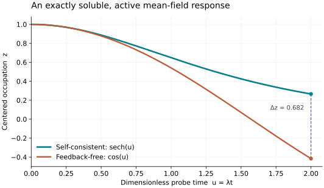

# Quantum Impurity Feedback

## Can a mean-field task retain a useful quantum computational advantage?

Consider an interacting quantum impurity and its bath, driven by a local field that depends on the impurity's own charge. Predicting one charge at a final time requires learning that field while solving the quantum dynamics. The question is whether a quantum algorithm can perform this **complete scalar-output task**, after charging its input, state preparation, repeated evolution, feedback acquisition and readout, in a regime not already covered by an analytic or efficient classical shortcut.

This repository develops three linked results:

1. **A finite-input quantum algorithm.** A noisy spectral reconstruction of the scalar charge field has a fully implemented logical-gate cost with inverse-linear accuracy dependence, up to logarithms, at fixed physical parameters and fixed failure probability. Every response experiment prepares the initial state and replays its complete evolution prefix. The reconstruction extends to a fixed number of bounded fields when their Hamiltonian and measurement implementations are explicitly supplied and charged.
2. **A substantial classical easy regime.** A quadratic bath with a fixed impurity and a Gaussian initial state admits an explicit Poisson/Dyson/Wick estimator. When the non-Gaussian interaction action and feedback action are logarithmic in input size, and the remaining resources are polynomially bounded, the entire feedback task is classically polynomial.
3. **A restricted hard family beyond that regime.** Explicitly programmable two-mode impurity dynamics retains a conditional complexity obstruction at nonzero feedback action. A source-free construction has a direct BQP-complete constant-gap decision problem, and its final feedback stage changes the same measured mean by more than $`0.08`$.

The advantage established here is a **conditional growing-input complexity separation**, assuming $`\mathrm{BPP}\ne\mathrm{BQP}`$. No practical device crossover or typical-material advantage is established. The hard family allows and pays for polynomially large controls; its universal quantum computation is inherited, and its final nonlinear probe has an analytic solution.

## The task

The input is an explicit finite list of Pauli Hamiltonian pulses, a known initial preparation, a local centered occupation $`A=1-2n_u`$, a final time $`T`$, and a feedback strength $`\lambda`$. The target equation is

```math
\dot\rho(t)=-i[B(t)+\lambda m(t)A,\rho(t)],
\qquad m(t)=\mathrm{Tr}[A\rho(t)].
```

Return one classical estimate of $`m(T)`$ with additive error $`\epsilon`$ and failure probability at most $`p`$. The corresponding occupation is $`(1-m(T))/2`$. The mean curve is unknown and must be acquired; an intermediate quantum state or a query oracle for that curve is not part of the input.

For the impurity application, $`B=Q+V+bA`$, where $`Q`$ is a quadratic bath Hamiltonian, $`V`$ is an interaction on a fixed number of impurity modes, and $`b`$ is an explicit source. The direct hard family sets $`b=0`$. Correlations inside the impurity–bath system are retained. Only its specified scalar charge coupling is closed at mean-field level.

The [model and output contract](science/model.md) also gives a collective-unit Hartree interpretation. The algorithmic error guarantee concerns the stated closed equation; a finite-array modeling error would require an additional physical approximation theorem.

## What the complete cost contains

Let $`\kappa=\lambda T`$ be the feedback action. The reconstruction uses $`P`$ time panels, polynomials of degree $`q`$, $`I`$ contraction rounds per panel and

```math
J=P(q+1)I
```

scalar acquisitions. With a computable base norm bound $`\Lambda`$, the parameter choices satisfy

```math
P=O(K+T\Lambda+\kappa L_q),\qquad
q,I=O\!\left(\kappa+\log(1/\epsilon)+\log L_q\right),
```

where $`K`$ is the number of supplied pulses and $`L_q=O(\log(q+1))`$ is a certified interpolation bound. Each nodal response has accuracy

```math
\delta=\Theta\!\left(\frac{\epsilon e^{-2\kappa}}{L_q}\right).
```

The [complete-cost theorem](science/complete-cost.md) constructs the sparse Hamiltonian circuits, reversible polynomial evaluator, time-dependent simulator, inverse circuits and amplitude estimation over a fixed gate set. Its gate bound has the form

```math
G=O\!\left[
\frac{J}{\delta}\log\!\frac{2J}{p}
\left(C_{\rm prefix}+C_{\rm prepare+reflect}\right)
\right],
```

with both costs explicitly implemented and bounded there. In particular, $`C_{\rm prefix}`$ includes a **full replay from the original input state on every call**.

| Resource | Treatment |
|---|---|
| Input data and pulse controls | Read as finite rational lists; term count, bit lengths, norms and durations are charged |
| Initial state | Known Fock product state in the main application; a more general supplied preparation is charged |
| Unknown feedback | Acquired at every required collocation node, including confidence amplification |
| Time evolution | Every full prefix, all pulse boundaries, and the final partial panel are simulated |
| Numerical implementation | Coefficient rounding, node timing, reversible arithmetic and fixed-gate synthesis are included |
| Classical work and storage | Input processing, coefficient transforms, circuit generation, every gate-control instruction and the stored field are included |
| Output | One classical scalar with specified error and failure probability |

At fixed model parameters and fixed failure probability the resulting precision dependence is $`\epsilon^{-1}\mathrm{polylog}(1/\epsilon)`$. The dependence on $`e^{2\kappa}`$, Hamiltonian resources and input size remains explicit. This is an upper bound; no universal classical $`\epsilon^{-2}`$ lower bound is asserted. At fixed Hilbert-space dimension, deterministic classical integration can have a better precision dependence.

## Where classical shortcuts work, and where the obstruction survives

Write the non-Gaussian interaction as a sum of normalized even Majorana monomials and define

```math
S=\int_0^T\sum_a|v_a(t)|\,dt.
```

For $`V=\chi n_un_v`$, after absorbing identity and quadratic pieces into $`Q`$, the quartic contribution is $`S=\frac14\int_0^T|\chi(t)|\,dt`$. This action differs from $`\kappa`$: a strongly interacting impurity can have large $`S`$ and moderate feedback action.

| Regime | Supported conclusion |
|---|---|
| Entire Hamiltonian and feedback remain quadratic, Gaussian input | Covariance-matrix evolution closes classically |
| Number-conserving vacuum or completely filled input | The occupation dynamics is trivial |
| Fixed impurity, Gaussian input, $`S+\kappa=O(\log N)`$ | The explicit classical estimator solves the full task in polynomial time when other resources and $`1/\epsilon`$ are polynomial in $`N`$ |
| General programmable impurity, $`\kappa=1`$ | A universal efficient classical estimator would imply $`\mathrm{BPP}=\mathrm{BQP}`$ by an adaptive reduction |
| Source-free, polynomial-strength compressed computation followed by an active probe | A direct BQP-complete constant-gap decision problem; feedback changes the final measured mean by a certified constant |

The [classical-boundary proof](science/classical-boundary.md) pays for finite sampling, Gaussian propagation, Pfaffian evaluation and feedback reconstruction. Its variance bound is exponential in $`S`$ and is a sufficient algorithmic bound, not a classical lower bound. Large $`S`$ alone does not certify hardness.

The [hardness proof](science/hardness.md) states the required controls, initial particle occupations, routing, rational compilation and decision promises. Compressing the computation into fixed time scales all required Hamiltonian strengths, including the quartic interaction. A fixed-time, fixed-strength claim would not follow from that construction.

## An exactly solvable diagnostic



For $`H=X+2zZ`$ starting at the positive $`Z`$ pole, the exact mean is $`z(t)=\mathrm{sech}(2t)`$. Removing feedback gives $`\cos(2t)`$. This observable difference is useful for checking signs, conventions and reconstruction error. **The one-qubit probe itself is analytically tractable.** The hard construction uses it only as an active transducer after the quantum computation. See [the exact solution and its role](science/examples.md).

## Learning route

The educational anchor is Lin Lin's [*Lecture Notes on Quantum Algorithms for Scientific Computation*, arXiv:2201.08309v1 (2022)](https://arxiv.org/abs/2201.08309v1). Start with the [learning entry point](learning/README.md), use the [source-to-project bridge](learning/BRIDGE.md) to connect its preparation, estimation and simulation framework to self-consistent impurity dynamics, and follow the [30-milestone map](learning/MILESTONES.md) for the complete conceptual route.

The map builds from local states and observables to the full algorithm, then integrates the classical boundary, hardness assumptions and meaning of the conditional advantage. The project supplies the nonlinear reconstruction and impurity-specific arguments that are outside the anchor's main scope. Specialist proofs remain in their authoritative science pages.

## Scientific account and verification

Start with the [scientific reading route](science/README.md), then follow the model, reconstruction proof, implementation costs, classical boundary and hardness argument. The [prior-work comparison](science/prior-work.md) distinguishes the contribution from established spectral self-consistency, quantum fixed-point estimation, nonlinear simulation and impurity universality. The [bibliography](references/REFERENCES.md) links the primary sources.

Four small-state numerical checks exercise noisy interpolation and prefix consistency, including an analytic reference solution. A separate rational-enclosure check verifies the constants in the active-probe corollary. These checks support the implementations and specified finite inequalities; they do not establish hardness or a hardware advantage. Run commands and requirements are in the [reproduction guide](verification/README.md); the [scientific verification account](science/verification.md) explains the methods, results and limits.

## Purpose

This repository serves as a record of the work and a guide for the author’s self-directed learning. For discussion or potential collaboration, please contact Ruge Lin at [gogoko699@gmail.com](mailto:gogoko699@gmail.com).
