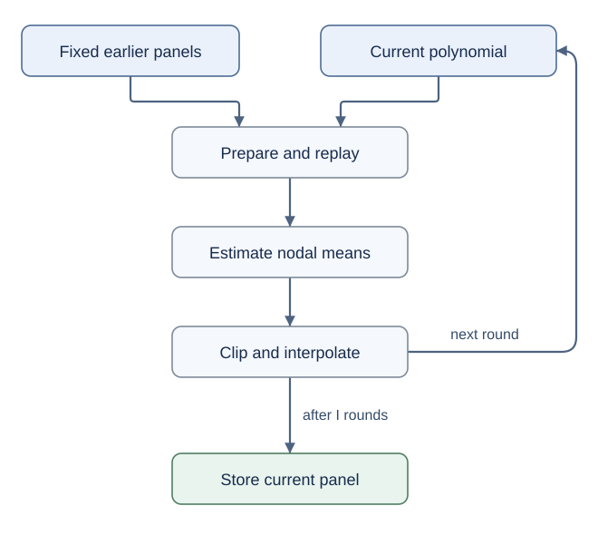

# From quantum algorithm primitives to a fully priced mean-field task

The selected anchor, [Lin Lin's *Lecture Notes on Quantum Algorithms for Scientific Computation*, version 1](https://arxiv.org/pdf/2201.08309v1), explains how states, circuits, estimation, matrix access, and simulation fit together. This bridge adds the steps needed when a measured quantum mean is itself an unknown coefficient of the Hamiltonian.

The [learning route](README.md) identifies the relevant anchor sections. The [milestone map](MILESTONES.md) organizes the project into 14 background and 16 narrative targets. The equations below explain the connections; the linked science pages contain the complete hypotheses, constants, and proofs.

## 1. A charge measurement with an unknown field

Consider an electronic impurity coupled to a bath of other fermionic modes. A selected mode is either empty or occupied when measured. Its occupation operator $`\mathstrut n_u`$ has outcomes $`\mathstrut 0`$ and $`\mathstrut 1`$. It is convenient to use the centered operator

```math
A=1-2n_u=Z_u.
```

An empty mode gives $`\mathstrut A=+1`$ and an occupied mode gives $`\mathstrut A=-1`$. If the system has density matrix $`\mathstrut \rho`$, the mean outcome is $`\mathstrut m=\mathrm{Tr}(A\rho)`$. The occupation probability is consequently $`\mathstrut (1-m)/2`$. A density matrix records the probabilities and correlations needed to predict measurements, including when the selected mode is entangled with the bath. Lin's Sections 1.1–1.5 introduce this state-and-measurement language.

The task specifies a finite pulse Hamiltonian $`\mathstrut B(t)`$ and a coupling $`\mathstrut \lambda\geq0`$. In units with $`\mathstrut \hbar=1`$, the equation is

```math
\dot\rho(t)=-i[B(t)+\lambda m(t)A,\rho(t)],
\qquad m(t)=\mathrm{Tr}(A\rho(t)).
```

The commutator $`\mathstrut [H,\rho]=H\rho-\rho H`$ describes the state change generated by the Hamiltonian. Here its coefficient $`\mathstrut m(t)`$ depends on the state being evolved. A specified initial preparation, the pulse data, $`\mathstrut T`$, and $`\mathstrut \lambda`$ define an initial-value problem. The requested result is one classical number satisfying

```math
\Pr\!\left[|\widehat m_T-m(T)|\leq\epsilon\right]
\geq1-p_{\rm fail}.
```

Throughout this bridge, $`\mathstrut p_{\rm fail}`$ denotes the failure probability called $`\mathstrut p`$ in the science pages. The symbol $`\mathstrut p(t)`$ will instead denote a trial field curve.

The physical closure has a specific scope. In the impurity application, $`\mathstrut B=Q+V+bA`$: $`\mathstrut Q`$ is quadratic in fermionic operators, $`\mathstrut V`$ is an interaction on a fixed impurity, and $`\mathstrut b`$ is a supplied source. Correlations inside the impurity–bath unit remain in $`\mathstrut \rho`$. The mean-field approximation concerns the designated charge coupling. Replacing all interactions by a quadratic Hamiltonian would produce a different, classically easier subclass. The [model](../science/model.md) gives both the finite input contract and the collective-unit Hartree interpretation. Its algorithm solves the closed equation; a finite-array modeling error would require an additional physical estimate.

## 2. Notation and access translation

The same letter can have different roles in the anchor and the project. The following translation prevents several important errors.

| Anchor concept or notation | Meaning in this project |
|---|---|
| A pure state $`\mathstrut \lvert\psi\rangle`$ or density operator $`\mathstrut \rho`$ | The full many-body state. The small impurity does not restrict this state to a constant-dimensional Hilbert space. |
| The preparation unitary in Section 4.2 | A compiled circuit that prepares the original input and simulates the entire prescribed-field prefix. Its cost and its inverse are charged. |
| Marked probability $`\mathstrut p_0`$ in Section 4.2 | The probability $`\mathstrut a_V`$ that the impurity readout bit is $`\mathstrut 1`$ after a particular compiled circuit $`\mathstrut V`$; its centered mean is $`\mathstrut 1-2a_V`$. |
| Failure parameter $`\mathstrut \delta`$ in Section 4.2 | Written $`\mathstrut p_{\rm fail}`$ here. The project's $`\mathstrut \delta`$ is instead an additive error allowance for one response estimate. |
| Query count denoted $`\mathstrut T`$ in part of Section 4.2 | Distinct from the project's physical duration $`\mathstrut T`$. One complete time prefix may be called many times during estimation. |
| Generic matrix $`\mathstrut A`$ in Chapter 6 | Distinct from the project's fixed local observable $`\mathstrut A=Z_u`$. The matrix being simulated here is $`\mathstrut B(t)+\lambda p(t)A`$. |
| A matrix-entry or block-encoding oracle | An access contract whose implementation must be constructed. Here the finite Pauli list and polynomial coefficients supply that construction. |
| Matrix sparsity $`\mathstrut s`$ in Section 6.3 | Called $`\mathstrut d\leq R+1`$ in the cost proof, where $`\mathstrut R`$ bounds the Pauli term count. It is unrelated to the interaction action $`\mathstrut S`$. |
| Ancilla count $`\mathstrut m`$ in Definition 6.1 | Distinct from the time-dependent mean $`\mathstrut m(t)`$. Work registers are included in the circuit and reflection costs. |

The state-error convention also matters. The project uses the full trace norm $`\mathstrut \|\rho-\sigma\|_1`$, without the factor $`\mathstrut 1/2`$ sometimes used in the definition of trace distance. For $`\mathstrut \|A\|\leq1`$,

```math
|\mathrm{Tr}[A(\rho-\sigma)]|
\leq\|\rho-\sigma\|_1.
```

Thus a bound on the whole state controls the requested scalar, although the algorithm never reconstructs that state classically. Operator norm bounds on Hamiltonians and trace norm bounds on states serve different roles.

### What the finite input provides

The main input is an explicit list of rational pulse boundaries and Pauli coefficients, a computational-basis occupation string, and finite parameters. The polynomial field is acquired during the algorithm. A preparation of an unknown interacting equilibrium state, an intermediate state, or an oracle for the exact mean curve is not among the supplied resources.

For a fixed trial curve $`\mathstrut p(t)`$, the Hamiltonian $`\mathstrut B(t)+\lambda p(t)A`$ is prescribed and Hermitian. Ordinary quantum simulation applies. Its response is an expectation of a circuit output, so the estimation methods in Lin's Sections 2.3 and 4.2 can be used after that circuit has been constructed. Selfconsistency adds a classical iteration around these prescribed-evolution experiments.

## 3. A complete two-mode example

Take two fermionic modes with exactly one particle, and use

```math
|0\rangle_L=|0_u1_v\rangle,\qquad
|1\rangle_L=|1_u0_v\rangle.
```

The occupation string $`\mathstrut |0_u1_v\rangle`$ is an easy initial preparation. Hopping between the modes acts as a logical Pauli $`\mathstrut X`$, and $`\mathstrut 1-2n_u`$ acts as $`\mathstrut Z`$. Choose

```math
H(t)=\frac12X+z(t)Z,
\qquad z(t)=\mathrm{Tr}[Z\rho(t)],
\qquad T=\lambda=1.
```

Writing $`\mathstrut x=\mathrm{Tr}(X\rho)`$ and $`\mathstrut y=\mathrm{Tr}(Y\rho)`$ gives

```math
\dot x=-2zy,\qquad
\dot y=2zx-z,\qquad
\dot z=y.
```

For the initial positive $`\mathstrut Z`$ pole, the solution is

```math
z(t)=\mathrm{sech}\,t,\qquad
x(t)=\tanh^2t,\qquad
y(t)=-\mathrm{sech}\,t\tanh t.
```

Substitution verifies all three differential equations and the initial values. At the requested time,

```math
z(1)\approx0.648054,
\qquad
\langle n_u(1)\rangle=\frac{1-z(1)}2\approx0.175973.
```

Removing the feedback term gives $`\mathstrut z_{\rm bare}(1)=\cos1\approx0.540302`$, so the occupation becomes approximately $`\mathstrut 0.229849`$. The feedback changes the requested occupation by about $`\mathstrut 0.053876`$. These numbers concern an exactly solvable small system; they demonstrate an effect and provide a reference answer, not a computational advantage. The [exact-example page](../science/examples.md) derives the more general critical probe and explains its separate use in the hard-family construction.

### How one field update obtains its data

Suppose the exact solution were not used. On a first short panel $`\mathstrut [0,h]`$, start with the trial field $`\mathstrut v_0(s)=0`$. The prescribed circuit then implements

```math
e^{-isX/2}|0\rangle
=\cos(s/2)|0\rangle-i\sin(s/2)|1\rangle.
```

Its readout probability is $`\mathstrut a(s)=\sin^2(s/2)`$ and its centered response is $`\mathstrut 1-2a(s)=\cos s`$. These are the quantities acquired by measurement or amplitude estimation. For a simple illustration using only the two endpoints, ideal linear interpolation produces

```math
v_1(s)=1+\frac{s}{h}(\cos h-1).
```

If the endpoint reports each have error at most $`\mathstrut \delta`$, their linear interpolant has error at most $`\mathstrut \delta`$ relative to this ideal update: each interior value is a convex combination of the two endpoint values. The next round simulates the explicitly known Hamiltonian $`\mathstrut X/2+v_1(s)Z`$ and obtains new responses. A scalar table is being revised; the state is prepared again for each experiment.

This two-node update illustrates the operation. The certified algorithm uses the polynomial degree, panel size, and number of iterations set by its error theorem. It does not identify one linear update with the nonlinear solution at the requested accuracy.

## 4. Reconstructing one scalar curve

The full algorithm divides the supplied pulse intervals into short panels. On a panel starting from a physical state $`\mathstrut \sigma`$, a trial real function $`\mathstrut v`$ determines a unitary propagator $`\mathstrut U_v(s)`$. Define its response curve by

```math
F_\sigma(v)(s)
=\mathrm{Tr}[A U_v(s)\sigma U_v(s)^\dagger].
```

The exact local mean satisfies $`\mathstrut m_\sigma=F_\sigma(m_\sigma)`$. This is a fixed-point relation: if the mean used to drive the dynamics equals the mean returned by those dynamics, the field is selfconsistent.

Choose $`\mathstrut q+1`$ Chebyshev–Lobatto times on the panel and interpolate the reported responses with a polynomial of degree $`\mathstrut q`$. These times are more concentrated near the endpoints than a uniform grid. Let $`\mathstrut I_q`$ denote this interpolation operation. Its Lebesgue bound $`\mathstrut L_q`$ measures the largest amplification of nodal errors into an error anywhere on the panel; the chosen nodes give $`\mathstrut L_q=O(\log(q+1))`$.

The algorithm iterates the finite map $`\mathstrut v\mapsto I_qF_\sigma(v)`$. Two different estimates make this useful.

**The exact mean is accurately approximable.** On a constant supplied pulse, the nonlinear density equation has a complex-time continuation in a disk whose radius is bounded using physical norms. The [analytic proof](../science/spectral-reconstruction.md#proof-part-1-physical-existence-and-dimension-independent-analyticity) obtains a radius proportional to $`\mathstrut 1/(\Lambda+\lambda)`$, independently of Hilbert-space dimension. Restricting the panel to a smaller interval gives an interpolation error decreasing geometrically with $`\mathstrut q`$. This statement concerns the exact local solution.

**The computed iteration is stable.** For arbitrary real trial fields $`\mathstrut v,w`$, unitary comparison gives

```math
\|F_\sigma(v)-F_\sigma(w)\|_\infty
\leq2\lambda h\|v-w\|_\infty.
```

Here $`\mathstrut h`$ is panel length and the infinity norm means the largest absolute value over that panel. The supplied Hamiltonian contributes the same unitary reference to both evolutions, so its large norm does not appear in this difference estimate. This is the project-specific use of the perturbation reasoning introduced in Lin's Section 1.6.

Interpolation changes the contraction factor to

```math
\theta=2\lambda hL_q.
```

Taking $`\mathstrut \theta\leq1/2`$ makes each ideal update reduce a discrepancy by at least a fixed factor. If each nodal response has error at most $`\mathstrut \delta`$, and the newly stored coefficients contribute at most $`\mathstrut \beta`$ in polynomial sup norm, a round introduces at most $`\mathstrut L_q\delta+\beta`$. Repeated contraction sums these errors geometrically rather than allowing an uncontrolled drift.

This separation is essential. The exact physical mean supplies analytic approximation. The noisy polynomial iterates need only be real and satisfy their finite coefficient bounds. The proof does not assume that measurement noise preserves a favorable analytic continuation.

The resulting parameter choices use degree and iteration count logarithmic in inverse final error at fixed feedback action. The [reconstruction theorem](../science/spectral-reconstruction.md#the-reconstruction-theorem) provides the explicit constants, boundary treatment, and finite-node implementation.

## 5. The panel-start state is a complete prefix

After several panels, the initial state for the next local problem is generally entangled and non-Gaussian. It is not freely available. Define $`\mathstrut \sigma_k`$ as the exact state produced from the original preparation by the already stored polynomial fields on panels before $`\mathstrut k`$.

Every response evaluation on panel $`\mathstrut k`$ prepares the original input, replays all those earlier panels, and then runs the current trial field up to the requested node. Once the classical history is fixed, this is an ordinary prescribed circuit. Estimation consumes its output; the next evaluation constructs a fresh copy through the same procedure.



After the final iteration, the stored polynomial defines the next prefix. This definition uses that final polynomial, even if the preceding nodal experiments used an earlier iterate. The next response replays the final recorded curve. Passing along a measured state from a preceding iteration would represent a different algorithm.

The local proof is uniform over every physical $`\mathstrut \sigma_k`$. A polynomial proxy can temporarily exceed the physical mean range between nodes, but its real coefficients still define a Hermitian Hamiltonian and a physical unitary evolution. Thus preceding measurement noise changes which physical prefix is analyzed, without invalidating the local theorem.

If each panel approximates its exact local nonlinear mean to error at most $`\mathstrut \eta`$, and $`\mathstrut D_k`$ is the state error at its start, then

```math
D_{k+1}\leq e^{2\lambda h_k}D_k+2\lambda h_k\eta.
```

The first term propagates an already present discrepancy under the nonlinear equation. The second accounts for using the stored local field. For an exact initial preparation, this yields

```math
\|\rho_{\rm stored}(T)-\rho(T)\|_1
\leq\eta(e^{2\kappa}-1),
\qquad \kappa=\lambda T.
```

The exponential feedback factor is part of the result. Choosing $`\mathstrut \eta`$ proportional to $`\mathstrut \epsilon e^{-2\kappa}`$ provides a final scalar error budget. The node count is fixed in advance, and every nodal confidence guarantee is uniform conditional on the earlier classical reports. A union bound therefore remains valid for adaptive queries. See the [global proof and response interface](../science/spectral-reconstruction.md#proof-part-4-global-error-from-local-physical-prefixes).

## 6. From a response circuit to the full cost

Lin's matrix-access and estimation chapters make clear which primitives an algorithm calls. This task additionally implements them from its finite input. The [complete-cost proof](../science/complete-cost.md) follows the chain from stored data to a logical gate list.

### A finite representation and a circuit for its values

There are $`\mathstrut P`$ panels, degree $`\mathstrut q`$, and $`\mathstrut I`$ rounds per panel. The number of scalar acquisitions is

```math
J=P(q+1)I.
```

Only $`\mathstrut O(Pq)`$ field coefficients are retained. On each panel the known polynomial can be evaluated reversibly by a Clenshaw recurrence, using arithmetic on finite bit strings. Its coefficients are constants in that panel's circuit. Earlier panels are simulated in temporal order. Coherent random access to a global table is unnecessary.

Each Pauli string maps a computational-basis row to one column determined by its $`\mathstrut X/Y`$ mask. An explicit scan of the finite Pauli list therefore implements the sparse location and matrix-value circuits. Their term count, string length, numerical precision, and polynomial evaluation are charged. Sparse access is a conclusion of this implementation, not a supplied unit-cost oracle.

The prescribed field varies within each panel. The cost proof uses a specified truncated-Dyson time-dependent simulator, with all pulse and panel jumps split exactly. Lin's Sections 5.1–5.2 and 7.7 explain simulation foundations; the required time-dependent theorem and fixed-gate compilation are research-level dependencies cited in the [bibliography](../references/REFERENCES.md#kieferova2019). Their circuit, derivative, and precision costs remain in the bound.

### Estimating the output of that circuit

For one compiled prefix circuit $`\mathstrut V`$, including input preparation and work registers, let

```math
a_V=\Pr\{\text{readout bit}=1\},
\qquad m_V=1-2a_V.
```

Amplitude estimation with additive probability error of order $`\mathstrut \delta`$ uses order $`\mathstrut 1/\delta`$ calls to the preparation and its inverse at constant success probability. The reverse is obtained from the actual finite gate list. Reflections include all required input and work registers. Repetition and a median supply the conditional confidence needed for all $`\mathstrut J`$ queries.

A useful error distinction follows. Compile one fixed $`\mathstrut V`$ accurately enough that its mean differs from the desired prescribed-field mean by $`\mathstrut O(\delta)`$. Estimation then targets the probability of that same $`\mathstrut V`$, using its exact circuit inverse. Repeated calls do not multiply this fixed target bias by the call count. Physical gate noise or a separately mismatched inverse would require a different analysis; the theorem concerns logical circuits.

The finite-phase and confidence details are part of the complete-cost proof. Exact binary eigenphases are not assumed. The final field value is returned from the last acquired polynomial endpoint; an additional observable would require another priced response.

### The error allowances have different jobs

| Symbol | Allocated task |
|---|---|
| $`\mathstrut \epsilon`$ | Requested error in the final classical mean |
| $`\mathstrut \eta`$ | Local field approximation error, chosen small enough for global nonlinear stability |
| $`\mathstrut \delta`$ | Total error of one nodal response, including circuit bias, timing, arithmetic, synthesis, and estimation |
| $`\mathstrut \beta`$ | Error made while computing a new polynomial coefficient list |
| $`\mathstrut \zeta`$ | Difference between the requested initial state and the fixed reference preparation; zero for the exact Fock input |
| $`\mathstrut p_{\rm fail}`$ | Probability that the complete output-error guarantee fails |

Rounding a new coefficient belongs to $`\mathstrut \beta`$. Evaluating that already stored coefficient during a later experiment belongs to the relevant response allowance $`\mathstrut \delta`$. Earlier recorded coefficients are part of the exact mathematical prefix used by that experiment. Keeping these roles separate prevents an omitted error or double counting.

### Why the precision power survives the complete loop

Let $`\mathstrut C_{\rm prefix}`$ denote the implemented cost of a full prescribed prefix, and let $`\mathstrut C_{\rm prepare+reflect}`$ include input preparation and the estimation reflections. The gate count has the form

```math
G=O\!\left[
\frac{J}{\delta}\log\frac{2J}{p_{\rm fail}}
\left(C_{\rm prefix}+C_{\rm prepare+reflect}\right)
\right].
```

The proof supplies finite bounds for both costs. It also charges classical input processing, coefficient transforms, circuit generation, every execution-control instruction, and field storage. No copy or prefix is hidden by treating a nodal response as a free query.

With $`\mathstrut K`$ supplied pulses and a computable base norm bound $`\mathstrut \Lambda`$, the parameter sizes satisfy

```math
P=O(K+T\Lambda+\kappa L_q),\qquad
q,I=O\!\left(\kappa+\log(1/\epsilon)+\log L_q\right),
\qquad
\delta=\Theta\!\left(\frac{\epsilon e^{-2\kappa}}{L_q}\right).
```

At fixed physical and input parameters, the extra accuracy dependence in the panel table, compilation, and replays is logarithmic. The complete cost is therefore $`\mathstrut \epsilon^{-1}\mathrm{polylog}(1/\epsilon)`$. Its dependence on $`\mathstrut e^{2\kappa}`$ and the numerical Hamiltonian resources remains explicit. Large norms do not become inexpensive because their binary descriptions are short.

This is a quantum upper bound. A one-qubit analytic solution, or deterministic classical integration at fixed small dimension, can have a better precision dependence. The quantum advantage question must also vary the admitted input family and challenge the response evaluations with classical algorithms.

## 7. The classical boundary uses two actions

The feedback action is $`\mathstrut \kappa=\lambda T`$. The separate non-Gaussian interaction action is

```math
S=\int_0^T\sum_a|v_a(t)|\,dt,
\qquad V(t)=\sum_a v_a(t)M_a,
\qquad \|M_a\|=1.
```

Here each $`\mathstrut M_a`$ is a normalized even Majorana monomial in the fixed impurity. A Majorana operator is a Hermitian combination of a fermionic creation and annihilation operator; Gaussian evolution transforms these operators linearly. The decomposition is specified and paid. For a density interaction $`\mathstrut \chi n_un_v`$, after its constant and quadratic parts are absorbed into $`\mathstrut Q`$, the quartic coefficient has magnitude $`\mathstrut |\chi|/4`$.

These two actions measure different burdens. The reconstruction's stability depends on $`\mathstrut \kappa`$. The classical interacting-response estimator below pays exponentially in $`\mathstrut S`$. A large bath alone establishes neither burden.

### Exact shortcuts come first

If the entire Hamiltonian and feedback remain quadratic and the initial state is Gaussian, its two-point correlation matrix determines the evolving state for the required observables. That matrix has polynomially many entries in the number of modes. A nonlinear scalar feedback can still close within this classical representation. A vacuum under number-conserving dynamics is an even simpler case: it remains the vacuum.

A fixed interacting impurity generally destroys the full state's Gaussian description. The comparator therefore keeps the interaction instead of replacing a later state by a Gaussian approximation.

### Expanding the interaction while keeping the bath exact

Fix a recorded field prefix. Its quadratic part can be propagated as a one-body matrix. In that interaction picture, write the interacting propagator as

```math
U_I(\tau)=e^{S_\tau}\,\mathbb E W,
\qquad S_\tau\leq S.
```

The word $`\mathstrut W`$ is sampled by choosing a Poisson number of interaction insertions, their ordered times, and their labels with probabilities proportional to coefficient magnitudes. Known phases recover the signs. Each word has norm one. Its expectation reproduces the time-ordered interaction expansion.

An observable requires both the forward evolution and its adjoint. With two independent words $`\mathstrut W,W'`$, the response is

```math
F_p(\tau)=e^{2S_\tau}\,
\mathbb E\,\mathrm{Re}\,\mathrm{Tr}
\left[\rho_0 W^\dagger O^I(\tau)W'\right].
```

The unscaled sample is bounded by one. Its products of transformed Majoranas can be evaluated using Gaussian two-point data and a Pfaffian, a polynomial-size algebraic expression that packages the pair contractions. The [classical proof](../science/classical-boundary.md) charges word truncation, finite random choices, time rounding, matrix propagation, and numerical Pfaffian accuracy. It never assumes that the interacting state at an intermediate panel boundary is Gaussian: every word pair includes the full prefix from the original Gaussian state.

The conservative sample count for one response is proportional to $`\mathstrut e^{4S_\tau}\delta^{-2}`$, with confidence factors. Applying the same feedback reconstruction yields a complete classical bound with the dependence

```math
\widetilde O\!\left(
J e^{4(S+\kappa)}L_q^2\epsilon^{-2}C_{\rm Wick}
\right),
```

plus the charged data work, where $`\mathstrut C_{\rm Wick}`$ is polynomial in the listed input and numerical resources. Therefore $`\mathstrut S+\kappa=O(\log N)`$ gives a classical polynomial-time regime when all remaining resources and $`\mathstrut 1/\epsilon`$ are polynomial in an input-size parameter $`\mathstrut N`$.

The exponential factor is the bound of this particular estimator. It is not a lower bound on classical simulation. Other structures and algorithms can do better. Likewise, its sampling exponent $`\mathstrut \epsilon^{-2}`$ is not a universal classical precision law. The useful conclusion is a rigorously priced easy regime that any broader advantage claim must respect.

## 8. How the qualified hardness statements fit

The [hardness account](../science/hardness.md) retains a quantum-interacting core. It encodes logical qubits using one particle per pair of modes. Quadratic hopping and phase controls implement single-qubit gates. Routing one selected rail from each of two logical qubits into the two impurity modes allows $`\mathstrut e^{-i\pi n_un_v}`$ to act as a controlled phase. Reversing the actual fermionic routing restores the modes and cancels its permutation conventions through an operator identity.

This uses a simple Fock input and a local occupation output. The constant impurity size does not make the entire evolution a constant-size calculation: gates can distribute correlations through an increasing number of bath modes. The [finite compiler](../science/hardness.md#2-bare-number-conserving-impurity-dynamics-can-encode-a-circuit) pays routing, rational gate approximations, durations, and control strengths.

### Causal transfer through adaptive scalar calls

A hypothetical solver for the feedback task can be asked for the actual mean at successive times. On each next interval, set an explicit source to $`\mathstrut b_j=-\lambda\widehat m_j`$ for the bare target with no source. Because $`\mathstrut A`$ commutes with its own source and feedback terms, the speed of the measured mean depends on $`\mathstrut [A,D(t)]`$, where $`\mathstrut D`$ is the remaining base Hamiltonian. A finite mesh controlled by a computable commutator bound keeps the uncancelled drive small.

Every query supplies the original state and the entire source prefix. Halting the Gaussian controls after a requested time leaves a Hamiltonian commuting with $`\mathstrut A`$, so a fixed-horizon terminal output can return that earlier mean. All later source choices respect causality. The construction uses polynomially many adaptive calls and is accordingly a **Turing reduction**. Its source values are finite recorded outputs of those calls.

### A separate direct family with an active final probe

The source-free corollary has a stronger control promise. It fixes $`\mathstrut T=\lambda=1`$, compresses an amplified quantum computation into $`\mathstrut t_c=1/1024`$ by scaling all required Hamiltonian coefficients, and then applies the two-mode probe for the remaining time. This includes scaling the quartic interaction strength; the resulting polynomially growing norms are charged.

The bare computation finishes close to a definite output pole. The probe retains a constant decision gap, and the difference between its feedback-on and feedback-off outputs from the same actual starting state is greater than $`\mathstrut 0.08`$ in the centered mean. The [direct corollary](../science/hardness.md#6-a-direct-source-free-hardness-corollary-with-an-active-probe) states the finite resource cap, decision promise, and error constants.

During computation the two interacting rails can come from different logical pairs. During the terminal probe, both rails of the single output qubit occupy the impurity pair, with one particle total, so $`\mathstrut n_un_v`$ vanishes on the ideal probe state. This explains why an interacting hard computation can be followed by the analytically simple probe without contradiction.

The resulting constant-gap promise problem is BQP-complete under the stated controls. An efficient randomized classical solver for all promised inputs would imply $`\mathstrut \mathrm{BPP}=\mathrm{BQP}`$. This is a conditional growing-input obstruction, not a proof of a particular exponential classical runtime. The hard computation is inherited from impurity universality; the probe demonstrates an active nonlinear effect on that output. No claim that typical material drives encode such circuits follows.

## 9. Reading the complete conclusion

Three statements now meet at the same scalar task:

| Statement | What it establishes | What remains outside it |
|---|---|---|
| Quantum reconstruction and implementation | A finite-input, fully charged upper bound, with inverse-linear precision power at fixed parameters | Efficiency at unbounded feedback action, free state access, or physical hardware overheads |
| Gaussian and interaction-action comparator | Explicit classical solutions for substantial subclasses and a priced easy-action regime | Optimal classical complexity for every drive or a universal sampling lower bound |
| Controlled impurity hardness | A conditional obstruction for growing programmable families, including a direct active-probe promise problem | Typical-instance hardness, fixed-strength compressed computation, or a demonstrated device crossover |

The field can have a short classical description while its nodal values remain difficult to compute classically. Conversely, a large Hilbert space or a visible nonlinear response can coexist with an efficient classical shortcut. The complete input, output, error, and access contract determines which conclusion applies.

The [prior-work comparison](../science/prior-work.md) credits spectral selfconsistency, noisy quantum fixed points, nonlinear simulation, and impurity universality. The contribution of this account is the stated combination of physical norm bounds, an implemented acquired-field interface, the full-task classical comparison, and qualified hardness consequences. It does not introduce every ingredient used in those arguments.

The [verification guide](../science/verification.md) explains the small-state checks and the certified probe inequalities. They test formulas and implementation behavior; the asymptotic claims rest on the proofs and input promises. Continue through the [30 milestones](MILESTONES.md) for the common conceptual sequence, or use the [scientific reading route](../science/README.md) for the theorem-level account.
