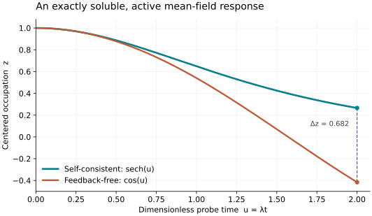

# An active feedback probe with an exact solution

A two-mode, one-fermion sector provides a transparent diagnostic. In its dual-rail basis, take

```math
H(t)=\Omega X+\lambda z(t)Z,\qquad
z(t)=\mathrm{Tr}[Z\rho(t)],\qquad
\rho(0)=|0\rangle\langle0|.
\tag{E1}
```

This is an analytically soluble instance. Its role is to expose the feedback effect and test the reconstruction, while the [hardness construction](hardness.md) supplies the separate computational obstruction.

## 1. Derivation of the critical probe

Writing the Bloch coordinates as $`(x,y,z)`$ gives

```math
\dot x=-2\lambda zy,\qquad
\dot y=2\lambda zx-2\Omega z,\qquad
\dot z=2\Omega y.
\tag{E2}
```

The Bloch length and the nonlinear energy

```math
x^2+y^2+z^2=1,\qquad
\Omega x+\frac\lambda2z^2=\frac\lambda2
```

are conserved. At $`\lambda=2\Omega`$, a solution satisfying the initial condition is

```math
z(t)=\mathrm{sech}(\lambda t),\qquad
x(t)=\tanh^2(\lambda t),\qquad
y(t)=-\mathrm{sech}(\lambda t)\tanh(\lambda t).
\tag{E3}
```

Direct substitution in (E2) verifies all three equations, including the initially zero derivative of $`z`$. Uniqueness of the finite-dimensional equation identifies this as the physical solution. Starting from the opposite pole gives $`z(t)=-\mathrm{sech}(\lambda t)`$, with the corresponding sign reversal of $`y`$ and unchanged $`x`$.

With the feedback term removed, the same $`\Omega X`$ drive gives

```math
z_{\mathrm{bare}}(t)=\cos(\lambda t).
\tag{E4}
```



At dimensionless time $`u=\lambda t=2`$, the centered charges differ by approximately $`0.68195`$. The physical occupations differ by half that amount. Thus feedback can alter the actual requested scalar by a constant even though this particular example is easy classically.

## 2. A nonlinear transducer after a hard computation

The same probe can follow a circuit-encoded impurity evolution. Amplifying the circuit decision makes the output dual rail close to one of the two poles. The nonlinear trace-distance stability bound controls its subsequent departure from the ideal trajectories in (E3). This produces a constant distinguishable final signal with an active terminal feedback response.

The [hardness account](hardness.md) states the complete encoding, pulse/norm charges and error constants. Its source-free construction concentrates the computation into a short interval and then applies this probe. Its hard computation is inherited from ordinary quantum universality; the analytic probe demonstrates that the final nonlinear response can remain active without erasing the decision signal. Concentrated controls are a paid assumption.

On a single-occupied impurity pair, $`n_un_v=0`$. The density-density impurity interaction therefore vanishes on that probe subspace even when it is always on elsewhere. This identity does not make the preceding interacting computation Gaussian.

## 3. Numerical verification and its scope

The reproducible checks compare the reconstructed trajectory with (E3), and also use a two-qubit model with noncommuting terms. Nodal perturbations include alternating signs, persistent bias and changing endpoint signs. The checked quantities include local field errors, contraction, the final mean, state error, coefficient bounds and selected fresh-prefix replays.

The reported calculations emulate small quantum states classically. They check finite formulas and implementation behavior, not quantum amplitude estimation, fault tolerance, general hardness or a hardware crossover. See [verification](verification.md) for the commands, numerical tolerances and full result records.

The figure uses only the exact functions (E3)–(E4); regenerate it with `python verification/plot_probe.py` from the repository root.
